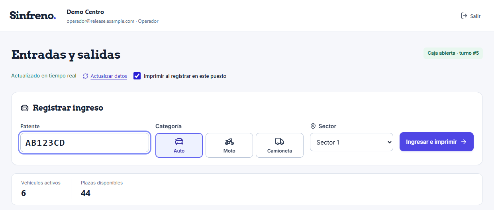
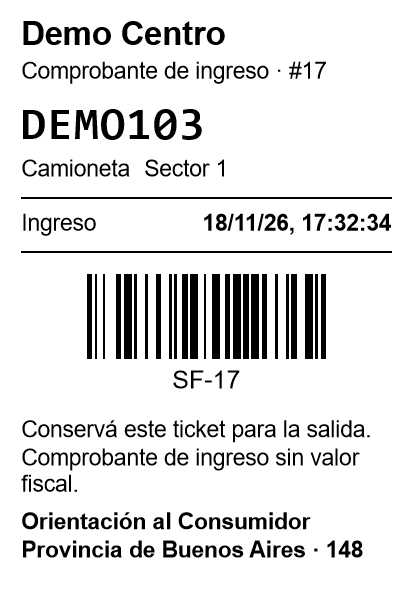
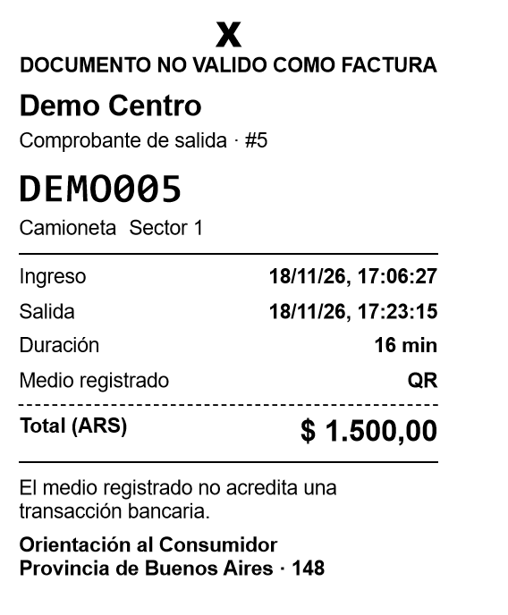
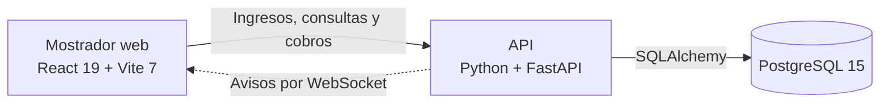

# Sinfreno · Gestión de cocheras rotativas

Sinfreno es una aplicación web para cocheras que cobran por tiempo de estadía. El operador registra la patente al entrar y usa el ticket para encontrar el vehículo al salir. Al terminar el turno, el administrador puede ver qué vehículos siguen adentro, cuánto se cobró y cuánto efectivo debería haber en el cajón.

**Proyecto de portfolio full stack** desarrollado con React, FastAPI y PostgreSQL. Se puede probar localmente con dos sucursales ficticias. La próxima validación es un piloto con operadores y una ticketera real en La Plata.

[Recorrido del producto](#del-ingreso-al-cierre-de-caja) · [Arquitectura](#cómo-está-construido) · [Pruebas](#qué-se-probó) · [Probar la demo](#demo-local-en-windows)



## Del ingreso al cierre de caja

1. **Ingresar.** El operador escribe la patente, elige auto, moto o camioneta y confirma el sector. El formulario valida el formato argentino mientras escribe. Con una caja abierta, presionar Enter registra el ingreso. Si activó *Imprimir al registrar en este puesto*, se abre la impresión del ticket.
2. **Cotizar.** Cuando vuelve el cliente, el operador busca por patente, escribe el número de ticket o lee su código de barras. La pantalla muestra el tiempo estacionado, la tarifa aplicada y el importe. En la demo, los primeros 10 minutos son de cortesía. Pasado ese límite se cobra la primera hora completa y luego fracciones de 15 minutos. La cotización tiene dos minutos de vigencia.
3. **Cobrar.** El operador verifica el pago, selecciona el medio y confirma el importe. El cobro queda asociado a la estadía y al turno. Si falta papel, puede reimprimir el comprobante. También puede recuperar sus comprobantes después de recargar la página.
4. **Cerrar el turno.** El administrador cuenta el efectivo y lo compara con el esperado. Por ejemplo, en un turno de la demo se registraron **ARS 500 en efectivo y ARS 1.500 por QR**. La recaudación fue de **ARS 2.000** y el arqueo cerró con **ARS 500 en el cajón**. [Ver el detalle de ese turno](docs/portfolio/screenshots/04-caja.png)

### Qué recibe el cliente

| Ticket de ingreso · 58 mm | Comprobante de salida · 80 mm |
| --- | --- |
|  |  |
| El código identifica la estadía. El número impreso permite buscarla a mano. | El cliente puede leer los horarios, la duración, el medio registrado y el total. |

Son dos estadías distintas de la demo. Ambos comprobantes se pueden imprimir en los dos anchos y descargar en PDF A6. El administrador puede agregar la dirección y el teléfono de la cochera. [Guía de tickets e impresión en La Plata](docs/comprobantes-la-plata.md) · [Galería de pantallas](docs/portfolio/README.md)

## Cómo está construido



La API calcula los importes y verifica el usuario, sus permisos y su sucursal. Cuando otro puesto registra un movimiento, el navegador recibe un aviso y vuelve a consultar los datos que ese usuario puede ver. Alembic versiona el esquema. La configuración de despliegue usa Docker, Caddy para HTTPS y Nginx para servir la aplicación. [Configuración de despliegue y respaldo](docs/deployment.md)

| Situación del negocio | Decisión de ingeniería |
| --- | --- |
| Cambia la tarifa mientras hay un auto estacionado | Cada ingreso nuevo guarda sus reglas. El servidor calcula con valores decimales y confirma el importe cotizado. [Motor de tarifas](backend/app/services/billing.py) |
| La conexión se corta justo después de confirmar un cobro | El navegador conserva el identificador del intento. Al volver, consulta el resultado o reenvía ese mismo pedido. El servidor reconoce la operación y evita duplicarla. [Recuperación de operaciones](backend/app/services/idempotency.py) |
| Otro puesto cobra mientras el administrador cuenta la caja | El cierre verifica el turno y sus totales. Si cambiaron, pide revisarlos y conserva el conteo ingresado. [Lógica de caja](backend/app/services/caja_service.py) |

## Qué se probó

| Verificación | Evidencia |
| --- | --- |
| **150 pruebas de backend** con PostgreSQL real | Tarifas, permisos por sucursal, operaciones simultáneas y recuperación ante fallos. [Pruebas de la API](backend/tests/) |
| **45 pruebas de frontend** | Sesión, intentos pendientes, validación de patentes y búsqueda por ticket. [Frontend](frontend/README.md) |
| **6 recorridos de punta a punta** en Edge con la API local | Ingreso por teclado, cotización y cobro, reimpresión, permisos y recuperación al perder una respuesta. [Pruebas de navegador](frontend/e2e/disposable-demo.spec.js) |

Las cifras corresponden a la versión `998235f`. GitHub Actions verificó frontend, backend y el arranque de las imágenes con HTTPS, WebSocket seguro y restauración de un respaldo. Los seis recorridos de navegador se ejecutaron por separado en la demo de pruebas. [Ejecución de CI](https://github.com/juann-ign/sinfreno-Parking-Central-SaaS/actions/runs/44439762852) · [Registro de QA](docs/recovery/RELEASE_2026-11-15.md)

## Demo local en Windows

Necesitás Git, Node.js 22.12 o posterior y Docker Desktop en modo de contenedores Linux. Desde PowerShell, cloná la **rama de portfolio** y prepará el entorno.

```powershell
git clone --branch release/portfolio-2026-11-15 https://github.com/juann-ign/sinfreno-Parking-Central-SaaS.git sinfreno
cd sinfreno
node scripts/init-release.mjs
```

Levantá la aplicación y cargá los datos ficticios. La primera ejecución descarga y construye las imágenes. El inicializador conserva las claves locales y la carga de datos de ejemplo se puede repetir sin duplicar las operaciones.

```powershell
docker --context desktop-linux compose --env-file .recovery/release.env -p sinfreno-release-20261115 -f docker-compose.release.yml up -d --build --wait --wait-timeout 180
docker --context desktop-linux compose --env-file .recovery/release.env -p sinfreno-release-20261115 -f docker-compose.release.yml exec -T backend python -m app.seed --confirm-disposable release_disposable
```

Abrí la aplicación e ingresá con una de estas cuentas. La contraseña compartida de la demo local es `Sinfreno-demo-local-2026`. [Abrir Sinfreno](http://127.0.0.1:15175) · [Explorar la API](http://127.0.0.1:18002/docs)

| Cuenta ficticia | Qué podés explorar |
| --- | --- |
| `operador@release.example.com` | Registrar entradas y cobros en Demo Centro. |
| `admin@release.example.com` | Revisar turnos, historial, equipo y tarifas de Demo Centro. |
| `admin.norte@release.example.com` | Ver los vehículos estacionados y los turnos de caja de Demo Norte. |

**Una prueba rápida.** Entrá como operador y registrá un auto con una patente libre como `AB123CD`. Cotizalo enseguida para ver la cortesía. En una demo recién sembrada, buscá `DEMO003` para ver una estadía que ya lleva más de una hora. Después entrá como administrador y abrí **Turnos** para revisar el desglose por medio de pago. [Guion de 90 segundos](docs/portfolio/DEMO_90S.md)

<details>
<summary>Detener la demo y volver a abrirla con los mismos datos</summary>

Desde la carpeta del repositorio, usá `stop` al terminar y `start` cuando quieras volver. El volumen conserva las estadías y la caja. Mantené el archivo local `.recovery/release.env` junto con esa instalación.

```powershell
docker --context desktop-linux compose --env-file .recovery/release.env -p sinfreno-release-20261115 -f docker-compose.release.yml stop
docker --context desktop-linux compose --env-file .recovery/release.env -p sinfreno-release-20261115 -f docker-compose.release.yml start
```

</details>

## Alcance del piloto

El circuito actual cubre cocheras rotativas por hora con atención en mostrador. Sinfreno registra el medio de pago y emite un comprobante operativo. La acreditación se verifica en el banco o proveedor de pagos y la factura se emite con el sistema fiscal de la cochera. La impresión y la lectura del código se verificaron sobre muestras digitales. Queda medir la entrega en papel, el tiempo de atención y el aprendizaje del operador en una cochera real.

Para una playa con abonos, tarifas de 12 o 24 horas, reservas, barreras u operación sin conexión hace falta desarrollo adicional. [Alcance comercial y alternativas para el piloto](docs/comprobantes-la-plata.md#cómo-decidir-el-siguiente-desarrollo)
