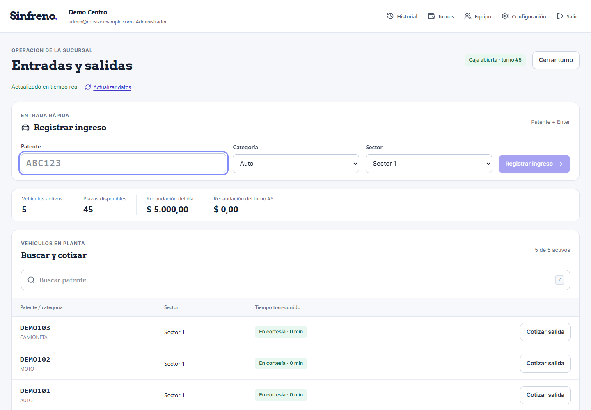

# Sinfreno — gestión de cocheras rotativas

Sinfreno reúne ingreso de vehículos, búsqueda, cotización, registro de cobros,
comprobantes y turnos de caja. Está dirigido a operadores y administradores de
cocheras, con permisos y datos separados por sucursal.

La release de portfolio usa datos ficticios. El 18/11/2026 se recorrió la
aplicación en Edge con backend real: teclado, dos terminales, sucursales,
recuperación, PDF y estilos de impresión, en notebook, escritorio y zoom nativo
200%. Se corrigieron dos defectos de comprobantes y se añadieron cuatro E2E.
La CI aprobó 149 pruebas de backend, 40 de frontend y el ensayo productivo
HTTPS/WSS. Falta validar la impresora y el circuito con una cochera real;
no hay demo pública ni piloto en uso. El
[registro de continuidad](docs/recovery/RELEASE_2026-11-15.md) conserva la evidencia.



[Cinco capturas verificadas](docs/portfolio/README.md) ·
[Demostración de 90 segundos y borrador de presentación](docs/portfolio/DEMO_90S.md)

## Demo local en Windows

Requisitos: Git, Node compatible con Vite (`^20.19.0 || >=22.12.0`), Docker Desktop
con contenedores Linux y espacio para imágenes, dependencias y PostgreSQL.
Desde PowerShell, en el repositorio:

```powershell
Set-Location C:\dev\sinfreno
node scripts/init-release.mjs
docker --context desktop-linux compose --env-file .recovery/release.env -p sinfreno-release-20261115 -f docker-compose.release.yml up -d --build --wait --wait-timeout 180
docker --context desktop-linux compose --env-file .recovery/release.env -p sinfreno-release-20261115 -f docker-compose.release.yml exec -T backend python -m app.seed --confirm-disposable release_disposable
```

Abrir [la aplicación local](http://127.0.0.1:15175). API y OpenAPI:
[127.0.0.1:18002/docs](http://127.0.0.1:18002/docs).

| Cuenta ficticia | Rol y alcance |
| --- | --- |
| `admin@release.example.com` | ADMIN, sucursal Demo Centro |
| `operador@release.example.com` | OPERADOR Demo Centro: ingreso, salida y ocupación |
| `admin.norte@release.example.com` | ADMIN, sucursal Demo Norte |

Contraseña de estas tres cuentas: `Sinfreno-demo-local-2026`. Son exclusivamente
para la base local descartable; el seed no crea SUPERADMIN.

`init-release.mjs` genera claves aleatorias en `.recovery/release.env`, fuera de
Git, y no sobrescribe el archivo existente. El arranque aplica migraciones pero
no crea usuarios. El seed es explícito, idempotente y rechaza otra base/usuario o
Telegram habilitado. Sólo para reiniciar deliberadamente **esta demo**, agregar
`--reset` a su comando. Conservar el entorno mientras se conserve la base.
El `.env` anterior y las demos SF-01/SF-02A no se utilizan ni se borran.

Al sembrar la demo se crean dos sucursales, cuatro sectores, cuatro estadías activas y un
turno cerrado con ARS 1.000 en efectivo y ARS 2.000 por QR: total ARS 3.000,
efectivo esperado ARS 1.000 y diferencia cero al contar ARS 1.000. Tiene otro
turno abierto para operar. Las operaciones posteriores modifican ese escenario;
el estado observado de la demo está en el registro. Las métricas provienen de
los registros y dependen del día consultado; no son resultados comerciales.

## Recorrido y reglas

1. Entrar como operador, revisar sucursal/caja e ingresar una patente. La caja
   abierta es obligatoria para ingresar y confirmar el egreso.
2. Buscar la estadía, pedir cotización, revisar importe y explicación, elegir
   medio y confirmar. La cotización dura 120 segundos; si vence, se reconfirma.
3. Recuperar el comprobante desde el resultado o **Mis comprobantes**, incluso
   después de recargar. Historial completo y finanzas requieren permisos.
4. Como ADMIN, revisar o cerrar el turno concreto, contando sólo efectivo físico.
   QR, tarjetas y transferencias no se contabilizan como faltante de efectivo.

La cortesía es inclusiva: hasta su límite el importe es cero; después se cobra
la primera hora completa y, superada una hora, fracciones configuradas. Con hora
ARS 1.000, cortesía 10 minutos y fracción 15 minutos: 10 minutos cuestan cero,
10 minutos y un segundo cuestan ARS 1.000, 60 minutos cuestan ARS 1.000 y
60 minutos y un segundo cuestan ARS 1.250, antes de descuentos.
La política es una decisión de demo que debe acordarse con una cochera.

Los importes usan Decimal/NUMERIC y redondeo `ROUND_HALF_UP` a dos decimales al
final. Cada ingreso nuevo conserva tarifas y reglas. El indicador de cortesía
usa los minutos de esa estadía, incluido cero, igual que la cotización: un ingreso
con 10 minutos sigue fuera de cortesía a los 15 aunque la configuración cambie a
20. Los heredados sin snapshot indican explícitamente que usan la configuración
actual; si las reglas no son válidas, la cortesía queda a revisar. Fechas nuevas
en UTC, visualización Buenos Aires; las históricas ambiguas requieren revisión
explícita sin inventar su zona horaria.

El servidor confirma el importe de la cotización persistida. Ingreso, cobro y
caja usan transacciones y claves idempotentes persistidas, con IDs concretos de
estadía y turno. Ante respuesta incierta, la UI conserva el mismo intento para
consultarlo o reenviarlo: no limpiar su almacenamiento ni iniciar un cobro nuevo.
El resultado no depende de recibir un evento WS. No hay conciliación offline.

Si los importes del turno cambian durante el conteo, el cierre actualiza los
totales, conserva el efectivo contado y las notas, y pide revisarlos antes de
confirmar. La interfaz verifica el turno seleccionado y envía la revisión de los
importes mostrados; el servidor rechaza una revisión desactualizada. El diálogo
conserva el turno original si se cierra o se abre otro.

Fondo inicial de caja: cero. No se modelan retiros, gastos ni caja chica. Registrar
un medio significa **Cobro registrado**, sin confirmación bancaria. Los
comprobantes son internos, sin integración fiscal, CUIT ni QR de pago inventados.

## Arquitectura y seguridad

React 19/Vite 7 consume FastAPI, SQLAlchemy y PostgreSQL 15; Alembic versiona el
esquema. El motor de cobro compartido vive en
[`billing.py`](backend/app/services/billing.py). Las mutaciones y su auditoría se
confirman juntas; locks y restricciones PostgreSQL sostienen capacidad, patente
activa y turno único ante concurrencia. El WS autenticado transmite avisos mínimos
para refrescar lecturas HTTP autorizadas después del commit.

JWT HS256 identifica al usuario; rol, permisos, actividad y sucursal se verifican
en base. La baja desactiva el acceso conservando identidad e historial. Los PDF
requieren autorización, usan `no-store`, escapan texto y rechazan recursos locales
y remotos. Producción exige secretos propios, PostgreSQL y orígenes HTTPS
explícitos. Ningún arranque crea una cuenta privilegiada de demo.

Directorios principales: `frontend/` (UI y conexiones), `backend/app/` (API,
dominio y modelos), `backend/alembic/versions/` (migraciones), `backend/tests/`
(motor, accesos, transacciones y concurrencia), `deploy/` (publicación preparada)
y `scripts/` (entorno descartable, backup y ensayo de proxy).

## Verificación

Verificación actual: **149 tests backend, cero skips**, PostgreSQL real;
**40 tests frontend**, lint/build y auditorías aprobados. Se conserva la evidencia
de smoke HTTP/WS, actualización representativa y backup/restauración con 11 tablas.
La variante de imagen `INSTALL_DEV=false` y `APP_ENV=production` se probó desde
base vacía, sin cuentas automáticas ni paquetes de test, con autenticación,
ingreso/cotización/cobro, recuperación, cierre, PDF y WSS mediante proxy TLS.
Auditorías npm completo/producción y Python runtime/dev: cero avisos
conocidos en la ejecución registrada. Esto no equivale a ausencia de todo riesgo.

En PowerShell, con la demo disponible:

```powershell
Push-Location frontend
npm.cmd ci --no-audit --no-fund
npm.cmd run lint
npm.cmd test
npm.cmd run build
Pop-Location
```

La suite completa backend usa fixtures que reinician su base: la CI la ejecuta
en un PostgreSQL nuevo. No ejecutarla sobre la demo conservada. Los cuatro
[E2E opcionales](frontend/README.md#e2e-opcionales-con-backend-real) usan la
instancia QA separada y conservan su historial. En PowerShell usar `npm.cmd` evita cambiar
ExecutionPolicy. [CI](.github/workflows/quality.yml) ejecuta estas verificaciones
con PostgreSQL en GitHub. El [run 44392068185](https://github.com/juann-ign/sinfreno-Parking-Central-SaaS/actions/runs/44392068185)
aprobó los tres jobs del commit `e60c66a` desde checkout limpio, incluido el
backend productivo sin herramientas de test. Ese resultado corresponde a ese
checkpoint de código. El QA local adicional aprobó cuatro E2E reales y ocho
pruebas PDF. La revisión al volver y la impresora física figuran en una única
checklist del registro.

## Despliegue, recuperación y presentación

- [Instalación, HTTPS/WSS, configuración privada, backup y contingencia](docs/deployment.md).
- [Caso de estudio, guion de demo y borrador de LinkedIn](docs/portfolio.md).
- [Registro de release: commits, evidencias y QA humano pendiente](docs/recovery/RELEASE_2026-11-15.md).
- [Frontend: variables públicas, reintentos, fuentes locales y desarrollo](frontend/README.md).
- Evidencia histórica: [SF-01](docs/recovery/01-entorno.md) y
  [SF-02A](docs/recovery/02a-accesos.md).

La configuración preparada usa Caddy HTTPS, Nginx estático y API/WS del mismo
origen, con PostgreSQL privado. Imagen/proxy se comprobaron en el ensayo local;
falta elegir host y dominio, proveer secretos propios y autorizar el despliegue.
El código y la documentación están publicados en la rama de release. Los secretos que
existieron en el historial requieren rotación externa por su titular; sanear un
ejemplo no los rota.

Fuera de alcance: abonos, reservas, OCR/barreras, integración ARCA o bancaria,
suscripciones SaaS y sincronización offline. Antes de un piloto hay que acordar
tarifas, usuarios, delegación de caja, equipamiento, impresión, pagos, respaldo y
contingencia con una cochera real.
