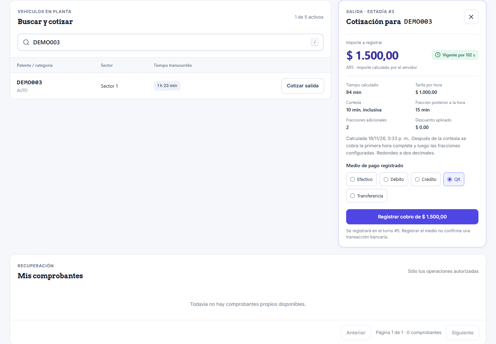

# Sinfreno: caso de estudio y presentación

Material de trabajo para portfolio. La evidencia ejecutada y los pendientes de QA están en [el registro de release](recovery/RELEASE_2026-11-15.md). No hay resultados comerciales, clientes ni mediciones de ahorro atribuidos a esta demo.

El 18/11/2026 se completó el recorrido en Edge contra el backend real. La
[galería de cinco capturas](portfolio/README.md) muestra el estado observado,
con datos ficticios. La demo local y sus cuentas se preparan según el
[README](../README.md#demo-local-en-windows).

## Problema y destinatarios

Una cochera rotativa necesita identificar rápido el vehículo, conocer el importe antes de confirmar y distinguir un cobro registrado de una operación todavía incierta. El operador necesita pocas decisiones por operación; quien administra necesita turnos y reportes que respeten su sucursal.

Sinfreno reúne ingreso, búsqueda, cotización, registro de cobro, comprobantes, caja e historial. La demo usa datos ficticios y conserva React/Vite, FastAPI, SQLAlchemy, PostgreSQL y Alembic.

## Decisiones de producto y UX

- Patente, búsqueda, importe y caja tienen prioridad visual. En el recorrido observado, escribir la patente y presionar Enter registró un único ingreso; no se midió productividad comercial.
- La cotización muestra monto, explicación, medio y vigencia en el mismo contexto. Confirmar registra exactamente una cotización válida o pide actualizarla.
- El indicador de cortesía usa las reglas de cada ingreso, incluido cero. Cambiar la configuración no altera el indicador de una estadía con reglas guardadas; los ingresos históricos muestran explícitamente cuándo usan la configuración actual.
- “Cobro registrado” describe lo que el sistema hizo. Seleccionar QR o tarjeta no certifica un pago bancario.
- Una respuesta incierta conserva el intento y permite consultar o reenviar su misma identidad. El usuario recibe una salida concreta para continuar, sin crear otro cobro por desconocer el resultado.
- Los comprobantes pueden recuperarse según autoría y permisos. El WS actualiza datos; la respuesta HTTP de la operación sostiene su resultado y comprobante.
- Si cambian los importes mientras se cuenta la caja, el cierre muestra los nuevos totales, conserva el efectivo contado y las notas, y exige revisarlos. Mantiene el turno elegido aunque deje de estar abierto o se abra otro.
- Caja cerrada, error de conexión, sesión inválida y lista vacía tienen mensajes distintos. Foco, teclado y reducción de movimiento forman parte de la interfaz.

## Decisiones técnicas que sostienen el flujo

| Punto de partida | Cambio implementado |
| --- | --- |
| Instalación, imports sensibles al casing y lint incompleto | Configuración reproducible y comprobaciones en Linux |
| Estado de sesión descartado ante fallos transitorios | Credencial conservada, acceso protegido cerrado y verificación reintentable |
| Operaciones basadas en patente/caja actual | Identificadores concretos de estadía, cotización, turno e intento |
| Fórmula replicada en tests y dinero flotante | Motor productivo compartido, Decimal/NUMERIC y redondeo explícito |
| Historial financiero sin separación suficiente | Alcance de sucursal y permisos efectivos desde la base |
| Broadcast con información de cobro | WS autenticado con avisos mínimos; lecturas HTTP autorizadas |

Las nuevas estadías guardan reglas al ingresar. La cotización y los metadatos mínimos del indicador resuelven las mismas reglas; un snapshot inválido deja la cortesía a revisar. Los datos heredados se identifican y no reciben tarifas o zonas horarias históricas inventadas. La cortesía inclusiva, primera hora y fracciones conservan la política elegida para la demo.

Las mutaciones usan transacciones e idempotencia persistida con alcance de sucursal, operación y autor. Los cobros pertenecen a un turno concreto; el arqueo separa efectivo de medios no físicos. La interfaz envía la revisión financiera del turno mostrado y el servidor rechaza un cierre con esa revisión desactualizada dentro de la transacción. Los reintentos conservan su identidad y sus datos originales. Las verificaciones de dinero, aislamiento y concurrencia se consultan en el registro, con sus límites de ejecución.

## Guion breve de demostración

El [guion de 90 segundos](portfolio/DEMO_90S.md) distribuye el recorrido por
tiempos e incluye el borrador actualizado de LinkedIn, sin publicar.

1. **Contexto:** entrar como operador ficticio, mostrar sucursal, estado de caja y vehículos. Explicar que los reportes generales corresponden a otros permisos.
2. **Ingreso:** registrar una patente nueva por teclado y mostrar el resultado/comprobante. Los sectores visibles corresponden a sus nombres o números, no a una suposición sobre IDs.
3. **Cobro:** seleccionar una estadía activa del dataset, revisar la cotización y registrar el medio elegido. Mostrar el comprobante desde el resultado y recuperarlo después de cerrar el aviso o recargar.
4. **Recuperación:** si existe un intento incierto de prueba preparado, consultar su resultado o reenviar el mismo pedido. Si no existe, explicar la garantía y remitir a las pruebas; no simular una confirmación inexistente.
5. **Administración:** mostrar el turno histórico mixto del dataset y distinguir recaudación total, efectivo esperado, contado y diferencia. Cerrar un turno sólo con el importe real del escenario que se está demostrando.

Se comprobaron acceso, PDF, estilos de impresión y teclado en 1366×768,
1440×1000 y zoom nativo 200%. Las cinco imágenes proceden de esa navegación.
La impresora física y la validación operativa con una cochera siguen pendientes.

## Límites y aprendizaje

El checkpoint de código `e60c66a` del 18/11 aprobó 149 tests de backend y 40 de frontend;
los cuatro E2E adicionales se ejecutaron localmente con Edge y servicios reales.
La CI también
construye la imagen del backend sin herramientas de test y la arranca como
producción sobre una base vacía: verifica cero cuentas automáticas y el circuito
de operación/PDF/WSS con TLS. Estos resultados son de datos sintéticos y pruebas
técnicas. El QA visual se documenta por separado; ninguno acredita resultados
comerciales.

La dificultad principal fue conectar permisos, dinero, tiempo y recuperación con las decisiones de la pantalla. Un botón deshabilitado ayuda al operador, pero la garantía necesita persistencia y controles del servidor. Una conexión abierta tampoco acredita aislamiento de eventos ni una descarga HTTP acredita calidad visual.

Quedan fuera confirmación bancaria, integración fiscal, barreras, abonos, reservas y operación offline con sincronización. Un piloto exige acordar tarifas, usuarios, delegación de caja, equipo, impresión, contingencia y circuito de pagos con una cochera real.

## Borrador de LinkedIn — no publicado

La versión preparada está junto al [guion de demostración](portfolio/DEMO_90S.md#borrador-de-linkedin--sin-publicar).
No se envió a redes sociales ni se desplegó públicamente la aplicación.
